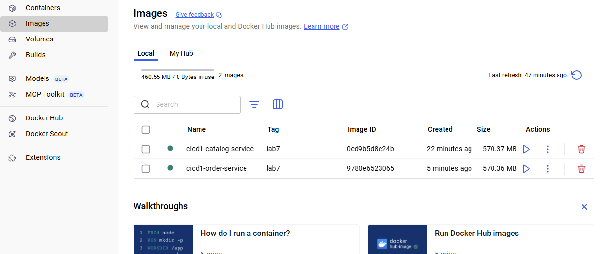

# CICD-1 Lab 7 catalog service

1. Maven package must run before docker build becuas eit creates the JAR file that Docker needs to copy into the Docker image.
2. Docker Image: A read-only template/package containing everything needed to run an application. Docker Container: A running instance of a Docker image. It executes the application.
3. 8082:8082 maps port 8082 on the Windows host to port 8082 inside the container. EXPOSE 8082 alone does not make the application accessible externally; you need -p 8082:8082 when running the container.
4. A Feign request to localhost may fail because each Docker container has its own network environment. Localhost refers to the container itself, not another container. The service name should be used to communicate between containers.
5. The Catalog Product survived because the database used persistent storage through a Docker volume. An in-memory H2 database would lose its data when the application stops because the data is stored temporarily in memory.

